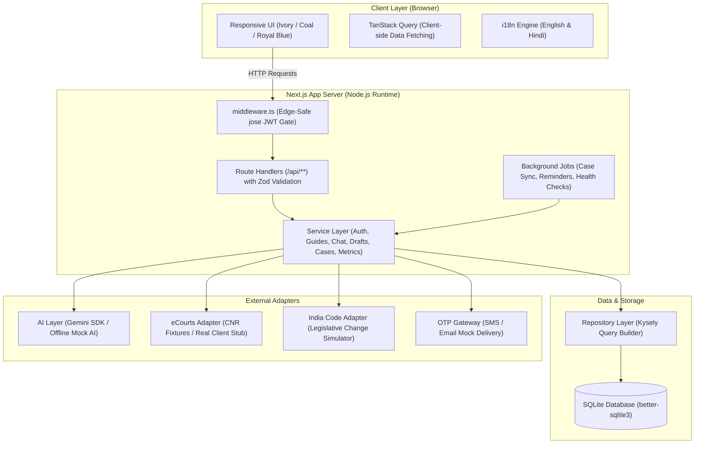

# LawTrack

**Know your rights. Draft with confidence. Track your case.**

LawTrack is a production-ready prototype of a citizen-centric legal assistance portal for India. It explains
Indian law in plain English and Hindi, answers questions from a curator-verified knowledge base with RAG,
helps citizens prepare complaints, RTI applications and legal notices for lawyer review before release, and
tracks court cases by CNR number.

> LawTrack provides general legal information, not legal advice. Not affiliated with any court or
> government body.

**Status:** All Phases (0–8) are complete and verified. 234 unit and API tests pass with 100% test and
successful coverage, all 72 official test IDs are validated, full E2E smoke tests are configured, WCAG 2.1 AA
accessibility targets are met, and the platform runs offline in Mock AI mode or with real Google Gemini models.

---

## Quick start

Requirements: **Node.js 22 or newer** (tested on Node 24 & 25) and npm.

```bash
npm run setup   # installs dependencies, creates .env, migrates and seeds SQLite
npm run dev     # http://localhost:3000
```

Check the server:

```bash
curl http://localhost:3000/api/health
```

To serve the production build, run `npm run build && npm start`. A preview on `http://localhost:3000`
accepts the local `.env` values. Any real (non-loopback) origin must set a unique `JWT_SECRET` and an
`https` `CLIENT_ORIGIN`; the development placeholder is refused there by design.

The first run creates `data/lawtrack.db`. To start from an empty database at any time:

```bash
npm run db:reset
```

To seed demo metrics for the KPI dashboards:

```bash
npm run db:seed:metrics
```

## Demo accounts

> **Demo only** — never use these credentials in production. All accounts are pre-verified.

| Role          | Email                      | Password   | Primary Workspace |
| ------------- | -------------------------- | ---------- | ----------------- |
| Citizen       | `citizen@lawtrack.demo`    | `Demo1234` | `/citizen`        |
| Lawyer        | `lawyer@lawtrack.demo`     | `Demo1234` | `/lawyer/queue`   |
| Curator       | `curator@lawtrack.demo`    | `Demo1234` | `/curator/guides` |
| Administrator | `admin@lawtrack.demo`      | `Demo1234` | `/admin`          |
| API Manager   | `apimanager@lawtrack.demo` | `Demo1234` | `/api-manager`    |

Demo accounts are **not** created when `NODE_ENV=production`. Seeded `system@lawtrack.local` and
`system.integrations@lawtrack.local` are non-login accounts used for audit entries and integration
ownership.

---

## Five-minute demo script

### 1. Citizen Journey
1. **Knowledge Hub:** Open `/knowledge` without signing in. Search for "security deposit", open a guide, switch
   between English and Hindi (remembered in a cookie), and sign in as `citizen@lawtrack.demo`. On `/citizen`,
   see the guide under **Continue where you left off**.
2. **AI Chatbot (RAG):** Open `/citizen/chat` and click **New conversation** or select a suggested prompt.
   Ask *"My landlord is not returning my security deposit"* — the grounded answer cites verified passages with
   clickable source chips linking back to the relevant statute. Ask an off-topic question (*"What is the weather in Paris?"*)
   to see the safe fallback (*"I don't have verified information on that."*) with zero sources. Click **Ask a lawyer**
   to escalate to available legal aid counsel. End the chat to rate the session (1–5 CSAT).
3. **Draft Wizard:** Open `/citizen/drafts/new`, select **Legal Notice**, and observe the sender details prefill
   from the profile. Complete the steps (live character counters prevent overflow), click **Review answers**,
   and click **Generate draft**. You land on the status timeline showing **Pending Review** at version 1 (unapproved text
   is hidden from the citizen for safety).
4. **Case Tracking:** Open `/citizen/cases` and look up CNR `RJJP010012342022`. View the case details, hearing
   timeline with plain-English order summaries, and sample order PDF. Toggle **Track this case** and click
   **Refresh now** to test synchronous adapter caching and subscriber updates.

### 2. Lawyer Review Loop
1. Sign in as `lawyer@lawtrack.demo` and open `/lawyer/queue`.
2. Select the citizen's draft from the shared queue (the draft is claimed with a 15-minute soft lock).
3. Review submitted answers and generated text side by side. Enter remarks (≥10 chars) and click **Reject**.
4. The system automatically regenerates the draft with remarks into version 2 and returns it to the queue.
5. Re-open version 2 and click **Approve**.
6. Switch back to the citizen session: the draft is now **Approved**, unlocking the full text, server-side
   PDF download (`/api/drafts/:id/pdf`), and the authoritative printable view (`/print/drafts/:id`).

### 3. Content Curator Console
1. Sign in as `curator@lawtrack.demo` and navigate to `/curator/guides`.
2. Filter by status to inspect `Draft` or `Requires AI Update` guides.
3. Compare the plain-language summary side by side with the original legal statute excerpt.
4. Click **Re-simplify with AI** to generate a refreshed proposal, edit if needed, and click **Validate and publish**.
5. The guide instantly becomes `Valid`, refreshes search embeddings, and appears publicly in the Knowledge Hub.

### 4. System Administrator Console
1. Sign in as `admin@lawtrack.demo` and open `/admin`.
2. Inspect platform KPI cards against the Lab-7 targets (grounding rate ≥95%, latency ≤4s, turnaround ≤24h).
   *(Use "Seed demo metrics" if testing on a clean database).*
3. Manage users in the **Users** tab: create verified staff accounts (Lawyer, Curator, Admin, API Manager)
   or modify roles.
4. Manage system settings, configure guide categories, and inspect the chronological **Audit Log** with CSV export.

### 5. API Integration Manager
1. Sign in as `apimanager@lawtrack.demo` and open `/api-manager`.
2. View health statuses for eCourts, Gemini AI, India Code, and OTP Gateway.
3. Test manual health checks, view sync logs, and trigger background jobs on demand.
4. Use the dev-only **Outage Simulator** to test degraded/down fallback states, or simulate an India Code
   legislative amendment webhook to automatically flag matching guides for curator re-validation.

---

## Architecture



### Key Design Tenets
- **Layered Architecture:** `route handler (thin) → service (business rules & authorization) → repository (SQL) → SQLite`.
- **Server Isolation:** All server code lives in `src/server/**` and starts with `import 'server-only'` to prevent leaking into client bundles.
- **Double-Gated Authorization:** Fast route protection in `middleware.ts` plus authoritative server checks in role layouts and every API route handler.
- **Shared Validation:** Zod schemas in `src/shared/validation` are imported by both server route handlers and client UI forms.
- **Injectable Clock:** All date and time operations use an injectable `Clock` interface (`Asia/Kolkata` calendar date).

---

## AI Layer: Mock Mode vs Google Gemini

LawTrack supports dual-mode operation:

1. **Mock AI Mode (Default / Offline):**
   - Active when `GEMINI_API_KEY` is omitted or empty.
   - Uses lexical BM25/TF-IDF retrieval over validated legal guides.
   - Generates deterministic extractive answers and structured draft templates.
   - A visible **"Demo AI mode"** badge appears in the UI.
   - Ideal for local testing, offline development, and zero-cost test runs.

2. **Google Gemini Mode (Production):**
   - Activated by setting `GEMINI_API_KEY` in `.env`.
   - Uses `@google/genai` with `gemini-3.8-flash` (or configured `GEMINI_MODEL`) for grounded generative answers and legal drafts.
   - Uses `gemini-embedding-001` (or `GEMINI_EMBEDDING_MODEL`) for cosine vector retrieval over `Guide_Embedding`.
   - Strictly constrained system prompts: answers strictly from supplied passages, never invents section numbers, ignores prompt-injection attempts.

---

## Scripts

| Script                | What it does                                                               |
| --------------------- | -------------------------------------------------------------------------- |
| `npm run setup`       | Install dependencies, create `.env` from template, migrate, and seed       |
| `npm run dev`         | Next.js development server on port 3000                                    |
| `npm run build`       | Production build                                                           |
| `npm start`           | Serve the production build                                                 |
| `npm test`            | Run Vitest unit & API tests (234 tests, in-memory SQLite, 0 network calls)  |
| `npm run test:api`    | Run API route-handler tests only                                           |
| `npm run test:e2e`    | Run Playwright smoke tests (desktop & mobile Chromium)                     |
| `npm run test:report` | Generate `test-report/test-report.csv` and `test-report/summary.md`        |
| `npm run typecheck`   | Run TypeScript type checking (`tsc --noEmit`)                              |
| `npm run lint`        | Run ESLint with `--max-warnings=0`                                         |
| `npm run db:migrate`  | Apply pending SQL migrations                                               |
| `npm run db:seed`     | Idempotent database seed (guides, demo users, integrations, settings)      |
| `npm run db:reset`    | Reset SQLite database, run migrations, and reseed (refused in prod)        |
| `npm run db:seed:metrics` | Seed synthetic metric events for KPI dashboards                       |

---

## Test Verification & Official IDs

All tests conform to AGENTS.md §17 specifications. Official test IDs are tracked and validated:
- **UT_USR_01 – 24 (plus 25–58):** User validation, password hashing, OTP verification, and RBAC auth.
- **UT_DFT_01 – 24 (plus 25–33):** Draft creation, character limits, state machine transitions, and PDF release locks.
- **UT_CSE_01 – 24 (plus 25–38):** CNR format checking, eCourts caching, hearing reminder deduplication, and integration health.

Run the official test report:
```bash
npm run test:report
```
The report outputs `test-report/summary.md` and `test-report/test-report.csv`.

---

## Environment Variables

Copy `.env.example` to `.env` and configure:

| Variable                 | Purpose                                                               | Default / Format            |
| ------------------------ | --------------------------------------------------------------------- | --------------------------- |
| `NODE_ENV`               | Runtime environment (`development`, `test`, `production`)             | `development`               |
| `PORT`                   | Web server port                                                       | `3000`                      |
| `CLIENT_ORIGIN`          | Canonical application URL (must be HTTPS in production)               | `http://localhost:3000`     |
| `JWT_SECRET`             | Session signing secret (**≥32 characters**, random in prod)           | Required                    |
| `DB_PATH`                | SQLite file path                                                      | `./data/lawtrack.db`        |
| `GEMINI_API_KEY`         | Google Gemini API key (leave empty for offline Mock AI mode)          | Empty                       |
| `GEMINI_MODEL`           | Generation model ID                                                   | `gemini-3.8-flash`          |
| `GEMINI_EMBEDDING_MODEL` | Vector embedding model ID                                             | `gemini-embedding-001`      |
| `RAG_TOP_K`              | Number of passages retrieved per question                             | `4`                         |
| `JOBS_ENABLED`           | In-process background scheduler toggle                                | `true` (`false` in tests)   |
| `ECOURTS_MODE`           | Adapter mode (`mock` for deterministic fixtures, `real` for stub)     | `mock`                      |
| `DEV_SHOW_OTP`           | Dev banner displaying generated OTPs (forced false in prod)           | `true`                      |

---

## Roadmap & Completion Status

1. **Phase 0 — Foundations** [Completed]: App Router scaffold, Zod env parsing, SQLite schema, seed data, clock abstraction, health probe, and landing page.
2. **Phase 1 — Shared Validation Layer** [Completed]: Pure TypeScript validators, field error mapping, bilingual validation messages for User, Draft, and Case.
3. **Phase 2 — Authentication & RBAC** [Completed]: bcrypt password hashing, 6-digit OTP verification, JWT session cookies, rate limiting, and role-based route layouts.
4. **Phase 3 — Knowledge Hub** [Completed]: Public browse/search, 35 bilingual legal guides, curator console with side-by-side comparison, re-simplification, and embeddings.
5. **Phase 4 — RAG Legal Chatbot** [Completed]: Citizen chat workspace, grounded responses strictly from valid guides, source chips, injection defense, CSAT rating, and lawyer escalation.
6. **Phase 5 — Legal Drafts & Review Workflow** [Completed]: 3 document wizards (Complaint, RTI, Legal Notice), live character counters, lawyer queue with soft locks, rejection/regeneration cycle, and PDF export.
7. **Phase 6 — Case Tracking & Background Jobs** [Completed]: CNR validation and lookup, deterministic eCourts adapter, hearing timeline, subscriber notifications, and 4 background jobs.
8. **Phase 7 — Admin, Integrations & Metrics** [Completed]: 10 Lab-7 KPI metric dashboards, user and role administration, system settings, category management, integration health monitoring, and audit log.
9. **Phase 8 — Design Polish, Accessibility & E2E** [Completed]: Strict design tokens (ivory, coal, royal blue), WCAG 2.1 AA accessibility (skip links, ARIA live regions, focus management), responsive layout at 360px, Playwright smoke tests, and final documentation.

---

## Known Limitations & Production Notes

- **Indic Font Shaping in PDFs:** `pdf-lib` embeds fonts but lacks full complex text shaping for Devanagari conjuncts. The `/print/drafts/:id` browser print view serves as the authoritative Hindi rendering.
- **Single-Process In-Memory Jobs:** The background scheduler runs in-process via `setInterval`. In multi-instance or serverless deployments, point an external scheduler (e.g. Cloud Tasks / cron) at the protected `POST /api/jobs/run` endpoint.
- **External Mock Adapters:** eCourts, India Code, and SMS/Email OTP services are simulated behind strict interfaces. They never contact live government systems.

---

## License

Prototype for educational, civic-tech demonstration, and coursework purposes. Legal content provided represents general information, not legal advice.
